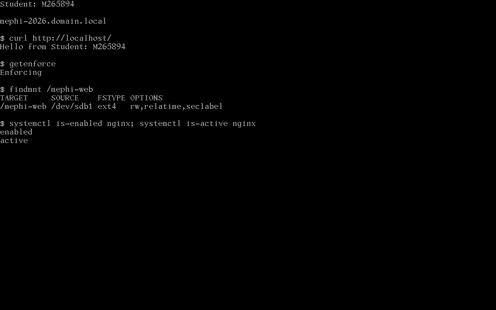
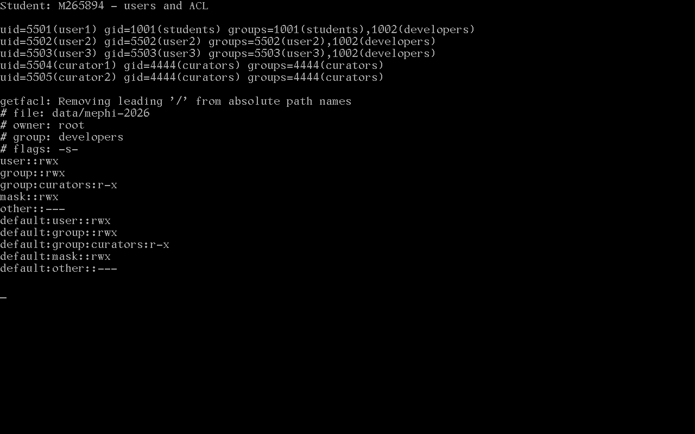

# Сессионный проект: безопасность GNU/Linux

Студент: **М265894**. Работа выполняется на клоне VMware `Clone of REDos`.

## Ограничения исходной установки

По согласованию с владельцем использована установленная РЕД ОС 8 Standard: сертифицированного образа нет. Соответствие сертифицированной редакции и сертификату ФСТЭК не заявляется. Исходная система была установлена с GUI; для проекта удалены GDM, GNOME Shell, сервер Xorg и их зависимые пакеты, выбран multi-user.target. Прочие ранее установленные приложения не удалялись. Это не является новой установкой из минимального сертифицированного образа.

## Настройки

| Требование | Реализация |
|---|---|
| Сеть | DHCP на ens33, hostname mephi-2026.domain.local, ping.out |
| Обновление | dnf upgrade, история dnf.out и полный журнал upgrade.log |
| Пакеты | nginx, libcap-ng-utils; tcpdump загружен через dnf download и установлен командой rpm |
| Диск | Новый отдельный виртуальный диск 10 ГБ, один раздел ext4, метка MEPHI_WEB, монтирование /mephi-web по LABEL в fstab |
| Разработчики | user1=5501, user2=5502, user3=5503; дополнительная группа developers |
| Кураторы | curator1, curator2; основная группа curators, GID 4444 |
| Каталог проекта | /data/mephi-2026, set-GID, ACL доступа и default ACL: разработчики rwX, кураторы r-X, остальные без доступа |
| tcpdump | cap_net_raw,cap_net_admin=ep, без set-UID; проверка захвата localhost от user1 |
| SELinux | Enforcing; постоянное правило httpd_sys_content_t для /mephi-web(/.*)? и restorecon |
| nginx | Автозапуск, корень /mephi-web, зависимость RequiresMountsFor=/mephi-web |
| Консоль | pam_access в /etc/pam.d/login запрещает группу curators; SSH этим правилом не блокируется |
| Пароли | PASS_MAX_DAYS=90 для новых пользователей, chage для существующих, minlen=12 и отключённые credits, enforce_for_root |
| Страница | Hello from Student: М265894 |

## Проверки и артефакты

Основные файлы: ping.out, stat.out, getcap.out, dnf.out, journalctl.out, getenforce.out, curl.out, history.out. Дополнительные результаты: acl-matrix.out, acl-check.out, password-policy-test.out, tcpdump-test.out, reboot-check.out.

Системные файлы сохранены в корне репозитория под своими именами; /etc/pam.d/login сохранён как pam-login, /etc/selinux/config как selinux-config. В shadow замаскированы хеши паролей, остальные поля сохранены. Пароли и закрытые резервные копии в репозиторий не включаются.

Default ACL наследуется обычными файлами, в том числе при umask 077. Однако владелец файла способен намеренно ограничить доступ через chmod или создать файл с явно ограниченным mode: стандартный DAC/ACL не гарантирует совместный доступ вопреки таким действиям. Для каталогов наследуется право поиска.

Изменения сохраняются при обычной перезагрузке. Восстановление старого снимка ВМ откатывает изменения; для восстановления результата необходим снимок, сделанный после настройки.

Проверка после перезагрузки выполнена 02.11.2026: ядро 6.12.101-1.red80.x86_64, nginx active/enabled, /dev/sdb1 смонтирован в /mephi-web, SELinux Enforcing, ответ curl корректен. Обновление завершилось с кодом 0. Журнал setup.log сохраняет также первоначальную неудачную попытку установки RPM обеих архитектур; затем явно выбран x86_64 и установка выполнена успешно.

В pam-test.out проверки идут в порядке: login для user1, user2, user3 (успешно), login для curator1, curator2 (отказ), sshd для curator1, curator2 (успешно). Проверяется стадия account PAM, а не ввод пароля в SSH.

Скриншоты получены непосредственно из консоли работающей ВМ командой VMware MKS captureScreenshot; изображения не генерировались и не редактировались.

